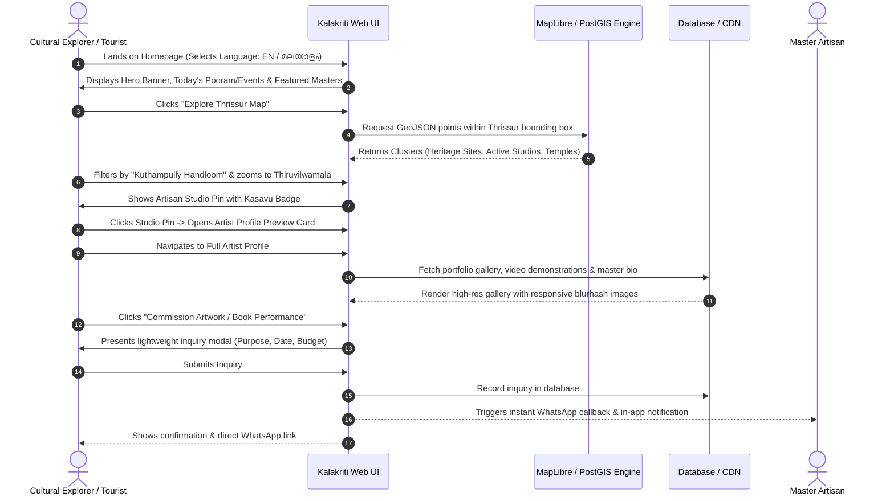
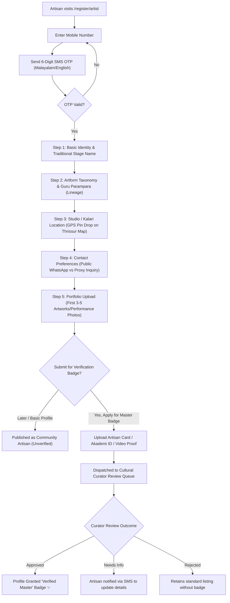
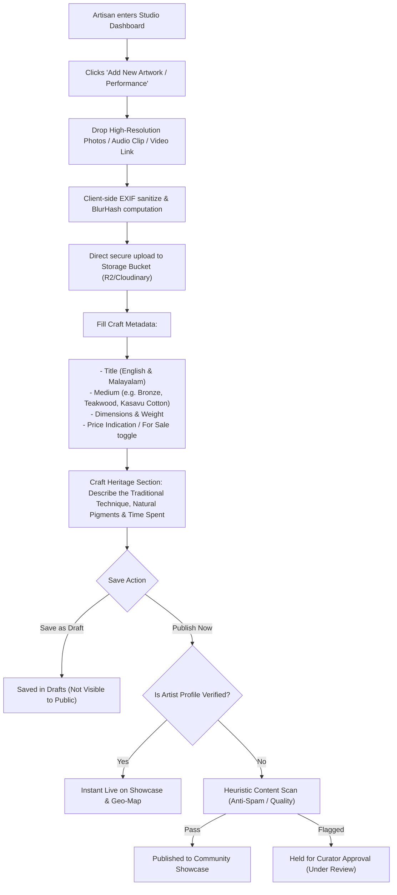
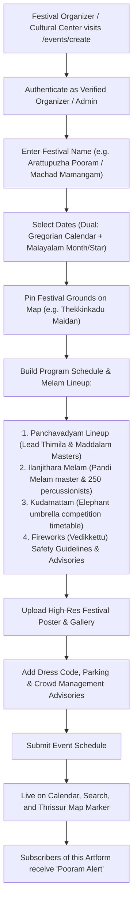
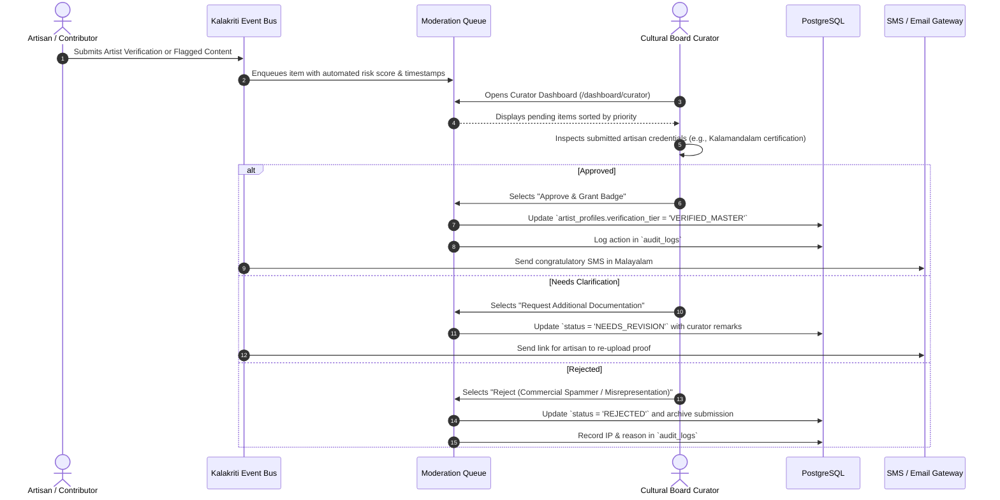
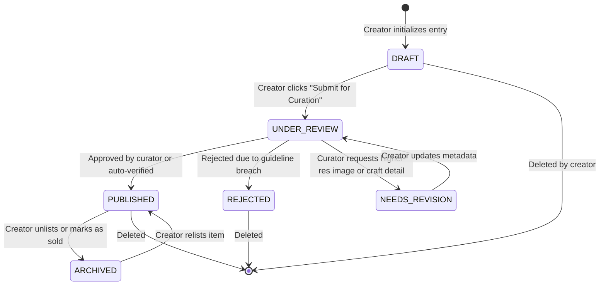
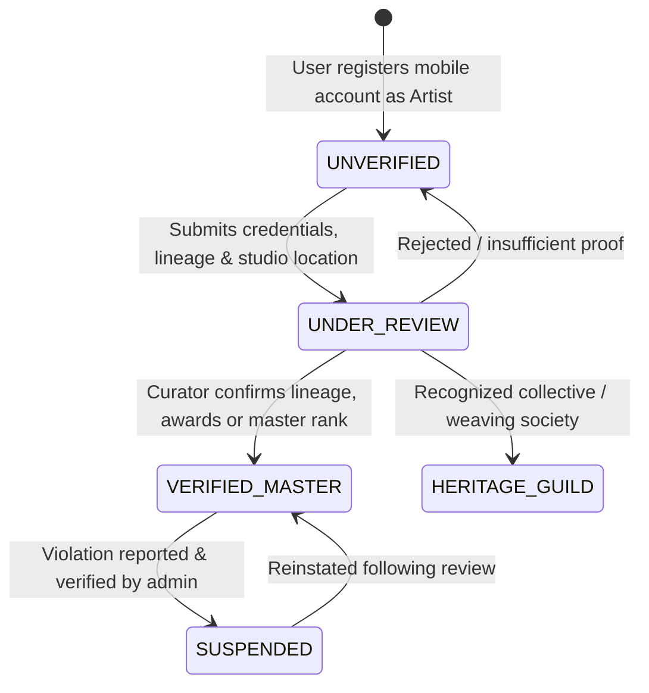

# Complete Application Flow (App_flow.md)
## KALAKRITI – Discover. Preserve. Showcase.
**End-to-End User Journeys, State Machines & Information Architecture**

---

### Document Control
- **Document Version:** 1.0.0
- **Scope:** Public Visitor, Artisan, Event Organizer, and Cultural Curator Flowcharts
- **Design Methodology:** User-Centric, Mobile-First, Culturally Sensitive

---

## 1. Information Architecture & Sitemap Tree

```mermaid
graph TD
    Home["Home (Landing Page / Hero Showcase)"]
    
    %% Main Navigation Branches
    Home --> Discover["/discover - Cultural Hub"]
    Home --> MapView["/map - Interactive Thrissur Map"]
    Home --> Artists["/artists - Artisan Directory"]
    Home --> Events["/events - Festival Calendar & Poorams"]
    Home --> Heritage["/heritage - Sacred & Historic Monuments"]
    Home --> Workshops["/workshops - Masterclasses"]
    
    %% Discover Branch
    Discover --> ArtformDetail["/artforms/[slug] - Dossier & Audio Guide"]
    Discover --> LivingTraditions["/artforms/categories (Performing, Melam, Craft, Textile)"]
    
    %% Map Branch
    MapView --> MapFilter["Filters: By Taluk, Heritage Sites, Studios, Live Events"]
    MapView --> GeoTrails["/trails/[trailId] - Curated Cultural Circuits"]
    
    %% Artists Branch
    Artists --> ArtistProfile["/artists/[id] - Portfolio, Bio, Studio & Guru Lineage"]
    ArtistProfile --> CommissionModal["Direct Commission & Performance Inquiry"]
    ArtistProfile --> ArtworkViewer["/artworks/[artworkId] - High-Res Lightbox & Story"]
    
    %% Events Branch
    Events --> EventDetail["/events/[slug] - Pooram Timetable & Melam Lineups"]
    EventDetail --> EventRSVP["RSVP & Calendar Sync (iCal / Google)"]
    
    %% Auth & User Portals
    Home --> Auth["/auth (Phone OTP / Google Login)"]
    Auth --> DashboardUser["/dashboard/explorer - Bookmarks & Inquiries"]
    Auth --> DashboardArtist["/dashboard/artist - Studio, Artworks, Workshops, Leads"]
    Auth --> DashboardCurator["/dashboard/curator - Verification Queue & Moderation"]
    Auth --> DashboardAdmin["/dashboard/admin - Platform Metrics & Audit Logs"]
```

---

## 2. Core User Journey Maps

### Journey 1: Public Cultural Explorer & Tourist Journey
Discovering traditional arts, exploring on the map, and inquiring with an artisan.

---

### Journey 2: Artisan & Traditional Performer Onboarding Flow
Empowering local masters and folk artists to self-register and get verified.

---

### Journey 3: Artwork & Craft Portfolio Publishing Flow
Adding a new traditional craft or performance with the story behind the art.

---

### Journey 4: Cultural Festival & Pooram Event Publishing Flow
Publishing temple festivals, percussion lineups (*Melams*), and cultural conventions.

---

### Journey 5: Curator & Moderation Review Lifecycle
How cultural administrators safeguard the platform against commercial spam and misrepresentation.

---

## 3. Entity State Machine Lifecycles

### 3.1 Artwork Showcase State Machine

### 3.2 Artist Verification Tier State Machine

---

## 4. Responsive UI Navigation & Breakpoint Strategy

| Screen Tier | Width | Primary Navigation Paradigm | Map Experience |
| :--- | :--- | :--- | :--- |
| **Mobile (`< 640px`)** | 360px – 639px | Fixed Bottom Navigation Bar (Home, Discover, Map, Saved, Profile) | Split-sheet bottom drawer (peek 25%, drag to 80% to view list) |
| **Tablet (`640px – 1024px`)** | 640px – 1023px | Collapsible Side Drawer + Sticky Top Header with Lang Toggle | 50/50 Dual Pane (Map left, Card feed right) |
| **Desktop (`> 1024px`)** | 1024px – 1920px+ | Persistent Cultural Header with Quick Search, Language Switcher & Profile Dropdown | Full-screen vector canvas with floating filter pill-box |

