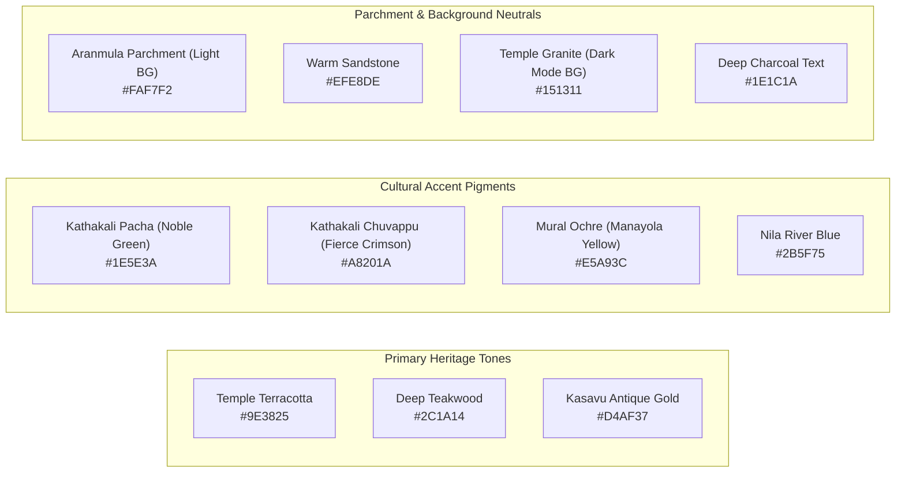

# UI/UX Design System (Design.md)
## KALAKRITI – Discover. Preserve. Showcase.
**Visual Identity, Cultural Tokens, Typography & Component Design Specifications**

---

### Document Control
- **Design Philosophy:** "Keraliya Elegance meets Modern Minimalism"
- **Primary Aesthetic:** Inspired by traditional Kerala temple architecture (*Vastu Vidya*), the warm bronze luster of *Nilavilakku*, the sacred gold borders of *Kasavu*, and the earth pigments of Kerala murals (*Dhyana Shloka* colors).
- **Target Form Factors:** Mobile-first responsive (360px) to Ultra-wide 4K displays (3840px).

---

## 1. Cultural Design Philosophy

Kerala's cultural capital, Thrissur, is defined by its deep historical roots, sacred spaces, and living arts. The UI avoids cold corporate tech aesthetics, embracing an inviting, warm, tactile experience:

1. **Earth, Wood & Metal:** Warm rosewood timber (`Teak / ഈട്ടി`), terracotta temple tiles (*Odu*), and polished brass (*Odu / Bell Metal*).
2. **Textural Authenticity:** Parchment tones reminiscent of ancient palm-leaf manuscripts (*Thaliyola*), subtly layered over clean modern geometry.
3. **Bilingual Harmony:** Balanced visual weight between Malayalam typography (curved, flowing scripts) and Latin typography (refined, dignified serifs and sans-serifs).
4. **Focused Immersion:** Generous whitespace framing breathtaking high-resolution photography of Kathakali mudras, Pooram processions, and artisanal bronze casting.

---

## 2. Color Palette & Design Tokens



### 2.1 Color Tokens & Tailwind CSS Mapping

| Token Name | Hex Code | RGB | Tailwind Class | Semantic Purpose |
| :--- | :--- | :--- | :--- | :--- |
| `color-primary-terracotta` | `#9E3825` | `158, 56, 37` | `bg-terracotta-600` / `text-terracotta-600` | Primary CTA buttons, key highlights, festival tags |
| `color-primary-teak` | `#2C1A14` | `44, 26, 20` | `bg-teak-900` / `text-teak-900` | Primary headers, dark navigation bars, footer |
| `color-kasavu-gold` | `#D4AF37` | `212, 175, 55` | `bg-gold-500` / `text-gold-500` | Verification badges, GI tags, award badges, subtle borders |
| `color-kasavu-glow` | `#FBF5DF` | `251, 245, 223` | `bg-gold-50` | Highlighted cards, active tab backgrounds |
| `color-pacha-green` | `#1E5E3A` | `30, 94, 58` | `bg-pacha-700` / `text-pacha-700` | "Open for Commissions" status, nature trails, active states |
| `color-chuvappu-red` | `#A8201A` | `168, 32, 26` | `bg-chuvappu-700` / `text-chuvappu-700` | Live event indicators, urgent moderation flags |
| `color-mural-ochre` | `#E5A93C` | `229, 169, 60` | `bg-ochre-500` / `text-ochre-500` | Star ratings, workshop category chips, interactive pins |
| `color-parchment-bg` | `#FAF7F2` | `250, 247, 242` | `bg-parchment-50` | Primary page background in Light Mode |
| `color-parchment-card` | `#FFFFFF` | `255, 255, 255` | `bg-white` | Elevated cards, dialog sheets |
| `color-granite-dark` | `#151311` | `21, 19, 17` | `bg-granite-950` | Primary page background in Dark Mode |
| `color-text-main` | `#1E1C1A` | `30, 28, 26` | `text-stone-900` | Primary body typography in Light Mode |
| `color-text-muted` | `#686461` | `104, 100, 97` | `text-stone-600` | Secondary descriptions, timestamps, metadata |

---

## 3. Typography System

The typography pairs authoritative classical serif typefaces for headers with clean, hyper-readable modern geometric typefaces for dense catalogs and mobile screens.

### 3.1 Font Families
- **Display & Headings (English):** `Playfair Display` or `Cormorant Garamond`
- **Display & Headings (Malayalam):** `Gayathri` or `Manjari` (Google Fonts)
- **Body & Interface (English):** `Plus Jakarta Sans` or `Inter`
- **Body & Interface (Malayalam):** `Noto Sans Malayalam`

### 3.2 Typographic Hierarchy Scale

| Level | Size (px / rem) | Line Height | Weight | Tracking | Primary Usage |
| :--- | :--- | :--- | :--- | :--- | :--- |
| **Hero Display (H1)** | 48px / 3.0rem | 1.15 | Bold (700) | -0.02em | Hero headline ("Discover the Soul of Thrissur") |
| **Page Title (H2)** | 36px / 2.25rem | 1.25 | Bold (700) | -0.01em | Section titles, Artform encyclopedia titles |
| **Section Header (H3)** | 24px / 1.5rem | 1.3 | SemiBold (600) | 0.0em | Card headers, Artist stage names |
| **Subheader (H4)** | 20px / 1.25rem | 1.4 | Medium (500) | 0.0em | Studio names, Event venue names |
| **Body Large** | 18px / 1.125rem | 1.6 | Regular (400) | 0.0em | Introductory paragraphs, lead text |
| **Body Default** | 15px / 0.9375rem | 1.55 | Regular (400) | 0.0em | Artwork descriptions, biographies |
| **Caption & Tags** | 12px / 0.75rem | 1.4 | Medium (500) | +0.02em | GI tags, dates, distance markers, badge chips |

---

## 4. Spacing, Elevation & Corner Geometry

### 4.1 Spacing Scale
Follows an 8-point harmonic grid:
- `space-1`: 4px | `space-2`: 8px | `space-3`: 12px | `space-4`: 16px | `space-6`: 24px | `space-8`: 32px | `space-12`: 48px | `space-16`: 64px

### 4.2 Corner Radius (Organic Softness)
Traditional Kerala architecture features gently curved eaves (*Charupadi*). Kalakriti utilizes gentle, welcoming curvature:
- Small Elements (Badges, Buttons): `rounded-lg` (8px)
- Cards & Modals: `rounded-2xl` (16px)
- Floating Bottom Sheets & Drawers: `rounded-t-3xl` (24px)
- Circular Avatars & Play Buttons: `rounded-full` (9999px)

### 4.3 Elevation & Shadows (Warm Sun & Nilavilakku Glow)
- `shadow-sm`: `0 1px 2px 0 rgba(44, 26, 20, 0.05)`
- `shadow-card`: `0 4px 20px -2px rgba(44, 26, 20, 0.08)`
- `shadow-glow-gold`: `0 0 15px 2px rgba(212, 175, 55, 0.25)` (used for Verified Master Badges)
- `shadow-floating`: `0 12px 36px -4px rgba(44, 26, 20, 0.16)` (used for mobile navigation bars and map filter sheets)

---

## 5. Component Library Specifications

### 5.1 Cultural Navigation Bar
- **Sticky Blur:** `backdrop-blur-md bg-parchment-50/90 border-b border-sandstone-200`
- **Branding:** Kalakriti Logo with Kerala Lamp (*Nilavilakku*) glyph and dual English/Malayalam logotype.
- **Bilingual Toggle Pill:** High-contrast switch `[ EN | മലയാളം ]` persisting across session cookies.
- **Search Command Palette:** Triggered via `⌘K` or search bar tap, searching artforms, masters, and heritage spots simultaneously.

### 5.2 The Artist Portfolio Card

```
+-----------------------------------------------------------+
| [ Cover Image / Artwork High-Res Preview ]                |
|  (Badge: [✨ Verified Master]  [📍 Cheruthuruthy, 12km] ) |
+-----------------------------------------------------------+
|  [Avatar]  Kalamandalam Sivan Namboodiri                  |
|            Master of Koodiyattam & Chakyar Koothu         |
|                                                           |
|  "Preserving 40 years of Sanskrit theatrical heritage"    |
|                                                           |
|  Specialties: [Koodiyattam] [Abhinaya] [Sanskrit Theatre] |
|                                                           |
|  [ 📞 WhatsApp Inquiry ]           [ View Studio & Works ]|
+-----------------------------------------------------------+
```

### 5.3 Interactive Map Marker Pin System
Custom SVG markers visually communicate the cultural category before clicking:
- 🏛️ **Heritage Sites:** Deep Teak circular pin with Temple gopuram silhouette and Kasavu gold ring border.
- 🎭 **Master Artist Studios:** Ochre teardrop pin with a traditional Kathakali face icon.
- 🎪 **Pooram / Live Festival:** Pulsing crimson marker indicating live or upcoming event today.
- 🧵 **Craft & Handloom Cluster:** Emerald Green pin with loom shuttle icon.

### 5.4 Festival Lineup & Pooram Timeline Widget
- Vertical chronological ribbon showing Pooram progress:
  - `06:00 AM` – Kanimangalam Sastha Ezhunnallippu
  - `11:30 AM` – Madathil Varavu (Panchavadyam led by 40 master percussionists)
  - `02:00 PM` – Ilanjithara Melam (Pandi Melam under the Ilanji tree)
  - `05:30 PM` – Kudamattam (Display of royal umbrellas on 30 caparisoned tuskers)
  - `03:00 AM` – The Grand Thrissur Pooram Fireworks (*Vedikkettu*)

### 5.5 High-Resolution Artwork Lightbox & Story Drawer
- **Main Viewport:** High-resolution zoomable image using WebP/AVIF.
- **Story Bottom Sheet (Expandable):**
  - **The Craft Process:** Artisans describe mineral pigments, bell metal alloy proportions, or hand-spinning Kasavu cotton.
  - **Dimensions & Medium:** Metric and imperial measurements.
  - **Direct Inquiry CTA:** Instant inquiry form with pre-filled artwork reference.

---

## 6. Accessibility & Cultural Inclusivity (a11y)

1. **Screen Reader Optimization:** Every traditional Malayalam term is provided with a phonetic `aria-label` (e.g. `aria-label="Panchavadyam - Traditional five-instrument temple orchestra"`).
2. **High-Contrast Audio Pronunciations:** Audio pronunciation icon next to each artform header so visitors can hear how to pronounce `കൂടിയാട്ടം` (Koodiyattam) or `മേളം` (Melam).
3. **Touch Targets:** Minimum 48px × 48px touch bounding box on all mobile buttons, chips, and map markers.
4. **Reduced Motion:** Respects `prefers-reduced-motion: reduce`, disabling large festival hero banner parallax and carousel automations.

