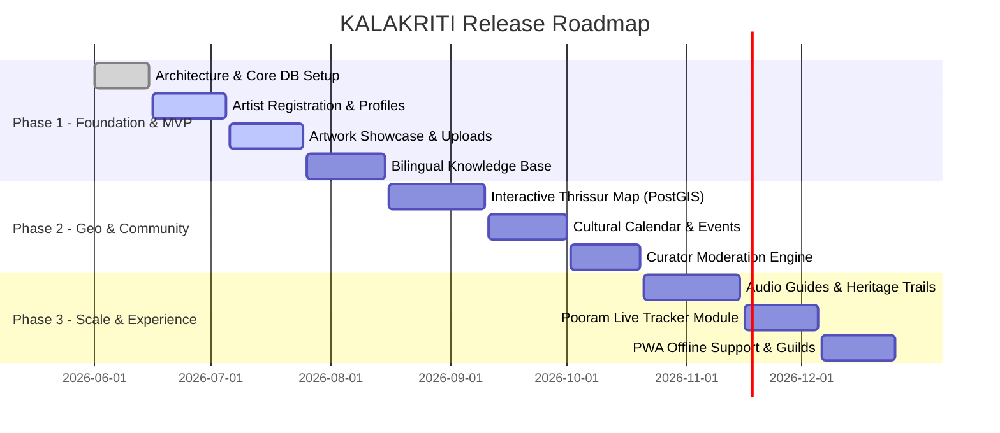

# Product Requirements Document (PRD)
## KALAKRITI – Discover. Preserve. Showcase.
**A Community-Driven Cultural Discovery & Artist Showcase Platform for Thrissur, Kerala**

---

### Document Control
- **Product Name:** KALAKRITI (കലാരീതി / കലാകൃതി)
- **Tagline:** Discover. Preserve. Showcase.
- **Geographic Focus:** Thrissur District, Kerala, India (The Cultural Capital of Kerala)
- **Target Launch:** Q3 2026
- **Status:** Approved for Architecture & Implementation
- **Version:** 1.0.0

---

## 1. Executive Summary & Vision

### 1.1 Vision Statement
To establish KALAKRITI as the premier digital cultural sanctuary for Thrissur district—democratizing visibility for indigenous masters and folk performers, safeguarding centuries of intangible cultural heritage, and connecting global cultural enthusiasts, researchers, and local patrons directly to the living heart of Kerala's arts.

### 1.2 Core Pillars
1. **Discover:** Intuitive, geolocated exploration of Thrissur's performing arts, master artisans, monumental heritage landmarks, festive gatherings, and hidden workshops.
2. **Preserve:** Rigorous digital archival of traditional artforms, GI-tagged crafts, temple mural techniques, oral folklore, and endangered classical and ritual practices.
3. **Showcase:** Empowering local artisans, craftsmen, and artists with autonomous digital portfolios, high-fidelity media galleries, commission channels, and event listings free from intermediary exploitation.

---

## 2. Cultural & Geographic Context: Thrissur District

Thrissur (തൃശ്ശൂർ), historically known as *Thrishivaperur* (the land of Lord Shiva), is officially recognized as the **Cultural Capital of Kerala**. It is home to world-renowned institutions, historic temples, monumental Christian basilicas, India's oldest mosque, and distinctive heritage villages:

- **Apex Cultural Institutions:**
  - *Kerala Kalamandalam* (Cheruthuruthy) – The world's epicentre for Kathakali, Koodiyattam, Mohiniyattam, and Thullal.
  - *Kerala Sangeetha Nataka Akademi* – Hub for theatre, folk arts, and the International Theatre Festival of Kerala (ITFOK).
  - *Kerala Lalithakala Akademi* – Patron of fine arts, sculpture, and traditional mural arts.
  - *Kerala Sahitya Akademi* – Custodian of Malayalam literature and linguistic heritage.
- **Iconic Festivals & Traditions:**
  - *Thrissur Pooram* – "The Mother of all Poorams" at Thekkinkadu Maidan, featuring the 30-elephant Kudamattam, Ilanjithara Melam, and magnificent Panchavadyam.
  - *Pulikali* (Tiger Dance) – The vibrant 4th-day Onam celebration encircling Swaraj Round.
  - *Temple Melams* – Pandi Melam, Panchari Melam, Thayambaka, and Maddalam Keli.
- **Living Crafts & Clusters:**
  - *Kuthampully Handloom* (GI Tagged) – Traditional Kasavu sarees and dhotis.
  - *Nadavaramba Bell Metal* – Casting of bronze *Urulis*, *Nilavilakku* (sacred lamps), and temple bells.
  - *Mural Painting Tradition* – As preserved at Vadakkunnathan Temple and the Guruvayur Institute of Mural Painting.
  - *Instrument Making* – Hand-carved Chenda, Maddalam, Edakka, and Thimila by master wood and leather artisans.
  - *Gold & Jewellery Artisans* – Thrissur accounts for over 70% of Kerala's gold ornament production with generational goldsmithing lineages (*Acharis*).

---

## 3. Problem Statement & Opportunities

| Existing Problem | Kalakriti Solution |
| :--- | :--- |
| **Fragmented Discoverability:** Cultural events, temple festival lineups, and artisan workshops are advertised via temporary hoardings, WhatsApp groups, or word-of-mouth. | Unified, real-time cultural calendar with interactive geolocated map pins, Malayalam date tracking, and itinerary builders. |
| **Artisan Invisibility & Intermediary Exploitation:** Traditional craftsmen (e.g., Kuthampully weavers, Nadavaramba bronze workers) earn low margins while middlemen profit. | Direct-to-artist showcase with verified profiles, commission inquiry gateways, contact numbers, and zero platform commission. |
| **Loss of Cultural Knowledge:** Rare ritual art forms (e.g., *Nangiar Koothu*, *Chavittu Nadakam*, *Kummattikali*) lack structured digital documentation and audio-visual archives. | Living Encyclopedia with taxonomy, historical lineage, audio pronunciation guides, and high-resolution multimedia documentation. |
| **Linguistic & Accessibility Barriers:** Existing tourism websites are heavily tourist-centric, primarily in English, and disregard the needs of local Malayalam-speaking artisans. | Truly bilingual platform (Malayalam & English) optimized for mobile-first access, budget Android devices, and low-bandwidth connections. |

---

## 4. User Personas & Target Audiences

### Persona 1: Unnikrishnan Master (The Traditional Artisan / Performer)
- **Age:** 58 | **Location:** Cheruthuruthy, Thrissur
- **Role:** Kathakali Chutti (Makeup) Artist & Chenda Performer
- **Needs:** A simple, mobile-friendly platform to showcase his past performances, list upcoming festival melams, and receive direct performance bookings or workshop invitations without technical hurdles.
- **Language:** Malayalam primary, limited English.

### Persona 2: Lakshmi Menon (The Cultural Tourist & Researcher)
- **Age:** 28 | **Location:** Bengaluru / Global Diaspora
- **Role:** Art Historian & Cultural Explorer
- **Needs:** Discover authentic cultural spots, verify visiting rules and dress codes for historic sites, listen to oral histories, find authentic handloom clusters, and attend weekend percussion workshops.
- **Language:** English primary, basic Malayalam.

### Persona 3: Anoop K. (Community Curator & Festival Committee Member)
- **Age:** 36 | **Location:** Thrissur Town (near Swaraj Round)
- **Role:** Paramekkavu Temple Committee Volunteer & Local Photographer
- **Needs:** Publish accurate festival schedules, upload high-resolution photographic essays of the Pooram exhibition and Melam lineups, and report cultural inaccuracies.

### Persona 4: District Administrator / Platform Moderator
- **Role:** Kalakriti Cultural Board Curator
- **Needs:** Review artist verification submissions, moderate user-submitted reviews and photographs, manage cultural taxonomies, and maintain cultural sanctity.

---

## 5. User Roles & Permissions Matrix

| Feature / Action | Anonymous Guest | Registered Explorer | Verified Artist / Artisan | Event / Center Organizer | Cultural Curator / Admin |
| :--- | :---: | :---: | :---: | :---: | :---: |
| Browse Public Showcase, Map & Encyclopedia | ✅ | ✅ | ✅ | ✅ | ✅ |
| Bookmark, Like & Save Itineraries | ❌ | ✅ | ✅ | ✅ | ✅ |
| Submit Review / Community Photo | ❌ | ✅ (Moderated) | ✅ | ✅ | ✅ |
| Send Direct Commission / Artist Inquiry | ❌ | ✅ | ✅ | ✅ | ✅ |
| Create & Manage Artist Portfolio / Artworks | ❌ | ❌ | ✅ | ❌ | ✅ (All) |
| Publish Workshops & Classes | ❌ | ❌ | ✅ | ✅ | ✅ |
| Publish Cultural Events & Festival Lineups | ❌ | ❌ | ❌ | ✅ | ✅ |
| Add Heritage Sites & Oral Stories | ❌ | ❌ | ❌ | ❌ | ✅ |
| Approve Artist Verification & Badges | ❌ | ❌ | ❌ | ❌ | ✅ |
| Content Moderation Queue & Flag Review | ❌ | ❌ | ❌ | ❌ | ✅ |

---

## 6. Functional Requirements (Epics & Feature Specifications)

### Epic 1: Authentication, Onboarding & Multilingual Profiles
- **FR-1.1:** Authentication options including Mobile OTP (SMS via Twilio/Fast2SMS for local artisans), Google OAuth, and Magic Links.
- **FR-1.2:** Role selection during signup: `Explorer`, `Artist/Artisan`, `Cultural Organization`.
- **FR-1.3:** Artist Onboarding wizard:
  - Stage name, biological name, guru/lineage (*Kula Gurunathan*).
  - Primary artform categorization (e.g., Kathakali, Mural Painting, Chenda).
  - Studio/workshop address with GPS pin picker.
  - Proof of trade (Artisan Card, Akademi membership, or video/photo portfolio) for verification badge.
- **FR-1.4:** Real-time language toggle (`English` ⇄ `മലയാളം`) with localized UI strings and bilingual content fallback.

### Epic 2: Artist Studio & Digital Showcase
- **FR-2.1:** High-resolution digital artwork and performance showcase.
- **FR-2.2:** Multi-image uploads with progressive blur hash loading and EXIF copyright preservation.
- **FR-2.3:** Audio/Video integration: Audio samples of vocal/percussion, YouTube/Vimeo embed for dance and theatrical arts.
- **FR-2.4:** Story behind the craft: Markdown/Rich-text editor allowing artisans to explain traditional techniques (e.g., natural vegetable dyes used in mural art, bell-metal casting ratios).
- **FR-2.5:** Commission & Performance inquiry form with auto-generated WhatsApp click-to-chat and email dispatch to the artist.

### Epic 3: Interactive Cultural Map & Geo-Discovery
- **FR-3.1:** Full-screen and embedded interactive map of Thrissur district with custom-designed cultural markers.
- **FR-3.2:** Category filtering:
  - 🏛️ Heritage Sites & Museums
  - 🎭 Performing Arts Stages & Mandapams
  - 🔨 Artisan Workshops & Master Studios
  - 🎪 Upcoming Festivals & Temple Melams
  - 🧵 Handloom & Craft Clusters
- **FR-3.3:** Taluk-level and Sub-regional bounds: Thrissur Town (Swaraj Round), Cheruthuruthy (Nila belt), Guruvayur & Chavakkad (Coastal), Kodungallur (Historic Muziris belt), Chalakudy (Highland/Forest), Thalapilly (Wadakkanchery).
- **FR-3.4:** "Heritage Trails": Curated navigational routes (e.g., *"The Vadakkunnathan Mural & Architecture Trail"*, *"The Kuthampully Weaver's Journey"*).
- **FR-3.5:** Geolocation detection for "Near Me" recommendations within a 5 km to 50 km radius.

### Epic 4: Cultural Calendar, Events & Workshops
- **FR-4.1:** Calendar view with dual Gregorian and Malayalam Era (*Kollam Era - ചിങ്ങം, കന്നി, തുലാം...*) date tracking.
- **FR-4.2:** Detailed festival program schedules (e.g., Pooram timetable: Madathil Varavu, Ilanjithara Melam, Kudamattam, Vedikkettu).
- **FR-4.3:** Workshop management: Artisans can host paid or free masterclasses with seat limits, prerequisites, and registration links.
- **FR-4.4:** Digital RSVP & "Remind Me" functionality with Google Calendar and iCal sync.

### Epic 5: Traditional Artforms & Heritage Knowledge Graph
- **FR-5.1:** Exhaustive taxonomy of Thrissur's arts:
  - *Classical Performing:* Kathakali, Koodiyattam, Mohiniyattam, Chakyar Koothu, Nangiar Koothu.
  - *Percussion & Orchestral:* Panchavadyam, Pandi Melam, Panchari Melam, Thayambaka, Maddalam Keli, Edakka Solo.
  - *Folk & Ritual:* Pulikali, Kummattikali, Chavittu Nadakam, Kolkkali, Daffmuttu, Margamkali.
  - *Crafts & Visual:* Mural Painting, Nadavaramba Bell Metal, Kuthampully Handloom, Kathakali Koppu Making, Temple Wood Carving.
- **FR-5.2:** Rich artform dossiers: History, costumes, instruments used, notable masters, audio pronunciation widget for Malayalam terms.
- **FR-5.3:** Geographical Indication (GI) registry highlight badge for recognized crafts.

### Epic 6: Community Stories, Reviews & Crowdsourcing
- **FR-6.1:** Community photo essays and heritage field notes.
- **FR-6.2:** Cultural appreciation and reviews on heritage locations and workshops.
- **FR-6.3:** Report inaccuracies or preservation alerts (e.g., damaged heritage structure, endangered artform query).

### Epic 7: Curation, Moderation & Trust Engine
- **FR-7.1:** Moderation dashboard for cultural administrators to review all unverified user posts, photos, and artist claims.
- **FR-7.2:** Verification Badges: `Verified Traditional Master`, `Heritage Guild`, `Emerging Folk Artist`.
- **FR-7.3:** Automated content filters for spam, profanity, and offensive media using image and text heuristics.
- **FR-7.4:** Audit logging for every administrative action.

---

## 7. Non-Functional Requirements (NFRs)

### 7.1 Performance & Responsiveness
- **First Contentful Paint (FCP):** < 1.2s on 4G mobile connections.
- **Time to Interactive (TTI):** < 2.5s.
- **Lighthouse Performance Score:** > 90 across Mobile and Desktop.
- **Image Optimization:** Automated Next.js AVIF/WebP transcoding with responsive breakpoints.
- **Offline / PWA Capability:** Service Worker caching for offline viewing of downloaded heritage trail maps and artisan contacts.

### 7.2 Accessibility & Internationalization (a11y & i18n)
- **Standards:** WCAG 2.1 AA Compliance.
- **Font Support:** Seamless rendering of complex Malayalam conjunct glyphs using Google Fonts (`Noto Sans Malayalam`, `Manjari`).
- **Contrast Ratios:** Minimum 4.5:1 for standard text; 3:1 for large display headers.

### 7.3 Security & Compliance
- **Data Protection:** Compliance with India's Digital Personal Data Protection Act (DPDP Act 2023).
- **Communication Privacy:** Artist phone numbers can be masked behind proxy or opted into direct WhatsApp click-to-chat.
- **Content Protection:** Right-click prevention options and watermarking overlays for sensitive traditional artwork images upon artist request.
- **API Security:** Rate limiting on OTP requests (max 3 per 10 minutes), CSRF protection, and JWT/HTTP-only secure cookies.

---

## 8. Success Metrics & Key Performance Indicators (KPIs)

| Objective | Metric | 6-Month Target | 12-Month Target |
| :--- | :--- | :--- | :--- |
| **Artisan Adoption** | Verified Artisans & Performers registered | 200+ master artists | 750+ master artists |
| **Community Engagement** | Monthly Active Users (MAU) | 25,000 MAU | 100,000 MAU |
| **Heritage Archival** | Documented Artforms & Heritage Points | 50 artforms, 120 sites | 100 artforms, 300 sites |
| **Economic Value** | Commission & Workshop Inquiries generated | 500+ inquiries | 3,000+ inquiries |
| **Festival Traffic** | Thrissur Pooram Live Schedule Pageviews | 150,000 sessions | 500,000 sessions |

---

## 9. Release Roadmap

