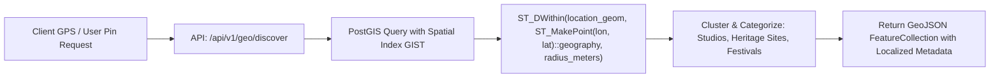
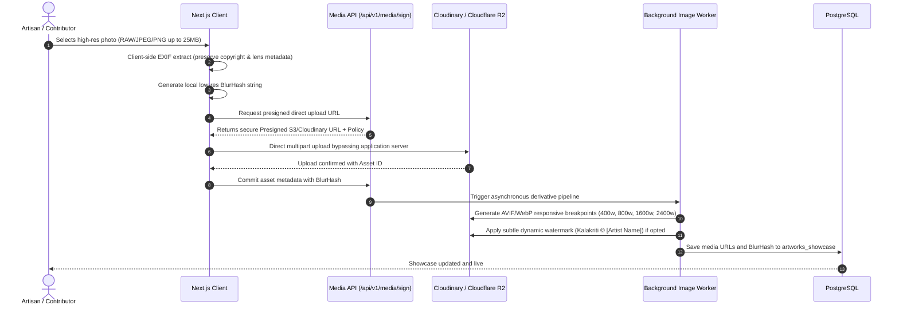
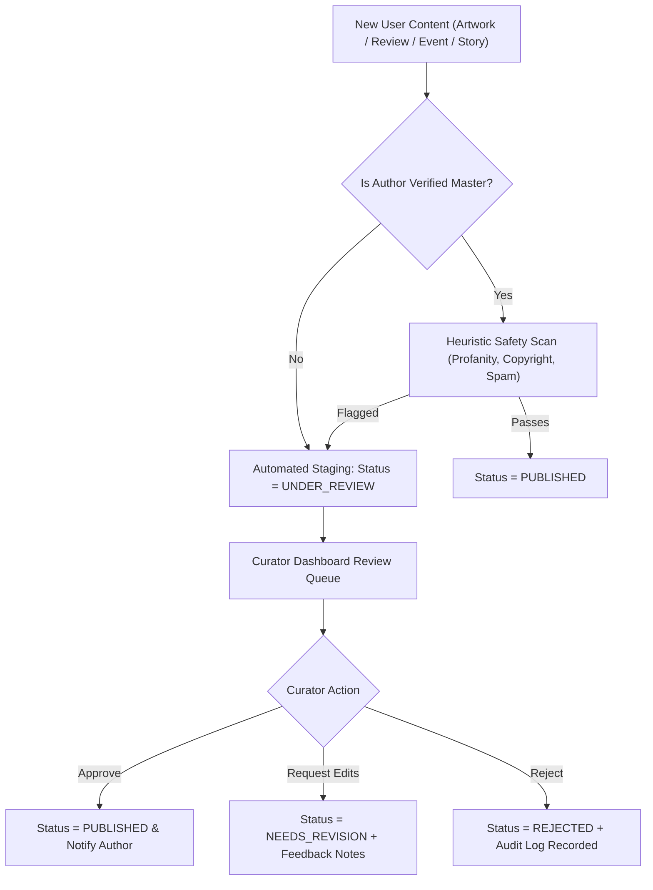
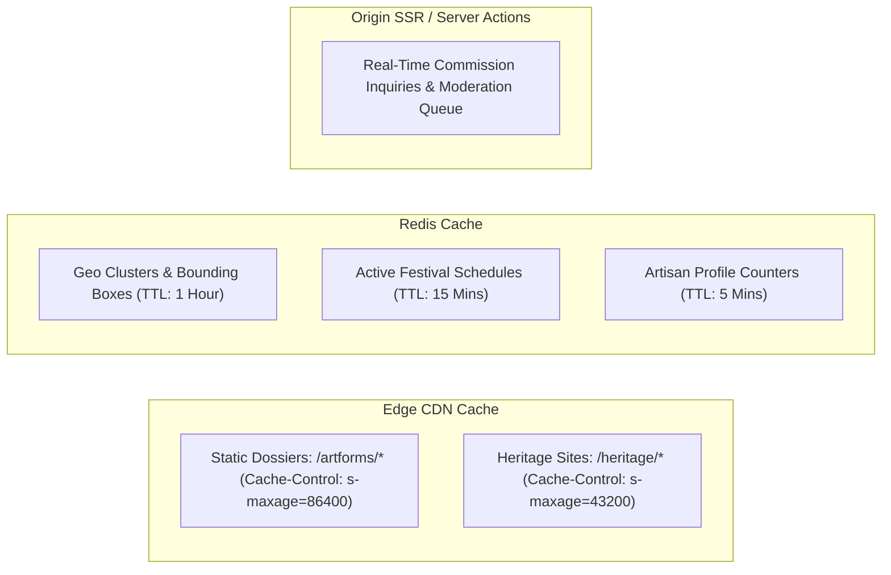

# Technical Requirements Document (TRD)
## KALAKRITI – Discover. Preserve. Showcase.
**System Architecture & Engineering Specification**

---

### Document Control
- **Document Version:** 1.0.0
- **Architectural Scope:** Full-stack Web Application, Geospatial Services, Media Pipeline & Curation Engine
- **Target Platform:** Desktop, Tablet & Mobile Responsive Web (Progressive Web Application ready)
- **Primary Region:** Asia South (Mumbai / ap-south-1) for lowest latency in Kerala, India

---

## 1. High-Level System Architecture

KALAKRITI is designed with a modern, modular, cloud-native architecture combining **Server-Side Rendering (SSR)** for SEO-critical cultural repositories and **Client-Side Hydration** for interactive maps and multimedia galleries.

```mermaid
graph TD
    subgraph Client Layer
        WebClient["Desktop / Mobile Browser (Next.js React 18 / 19)"]
        PWA["PWA Service Worker (Offline Cache & Trails)"]
    end

    subgraph Edge & Gateway Layer
        CDN["Cloudflare Edge CDN / Vercel Edge Network"]
        WAF["WAF & DDoS Protection (Cloudflare)"]
        DNS["Route 53 / Cloudflare DNS"]
    end

    subgraph Application Tier (Next.js 14+ App Router)
        ServerComponents["React Server Components (RSC)"]
        ServerActions["Server Actions (Mutations & Forms)"]
        APIRoutes["Route Handlers (/api/v1/*)"]
        AuthService["Auth.js v5 (NextAuth) Session Engine"]
        SearchEngine["Search & Taxonomy Engine"]
    end

    subgraph Geospatial & Storage Layer
        Postgres["PostgreSQL 16 + PostGIS Extension (Neon / Supabase / AWS RDS)"]
        Redis["Redis Cache (Upstash / ElastiCache)"]
        ObjectStorage["Cloudflare R2 / AWS S3 / Cloudinary (Images & Audio)"]
    end

    subgraph Third-Party Integrations
        SMSGateway["Fast2SMS / Twilio (OTP Verification)"]
        MapTiles["MapLibre GL / OpenStreetMap / Mapbox Tiles"]
        EmailService["Resend / AWS SES (Transactional Alerts)"]
    end

    WebClient --> DNS
    DNS --> WAF
    WAF --> CDN
    CDN --> ApplicationTier
    ServerComponents --> Postgres
    ServerComponents --> Redis
    ServerActions --> Postgres
    ServerActions --> AuthService
    APIRoutes --> Postgres
    APIRoutes --> SearchEngine
    ApplicationTier --> ObjectStorage
    ApplicationTier --> SMSGateway
    ApplicationTier --> EmailService
    WebClient --> MapTiles
```

---

## 2. Technology Stack & Decision Rationale

| Tier | Technology | Selected Version | Engineering Rationale |
| :--- | :--- | :--- | :--- |
| **Frontend Framework** | Next.js (App Router) | `14.2+` / `15.x` | Hybrid SSR/SSG enables instant page loads and maximum SEO indexing for traditional artforms and artist portfolios. |
| **Language** | TypeScript | `5.4+` | Strict type safety across database models, API contracts, and UI components; minimizes runtime exceptions. |
| **Styling & UI** | Tailwind CSS + Radix UI (Shadcn/UI) | Tailwind `3.4+` | Utility-first CSS provides bespoke styling matching Kerala's cultural aesthetics without bloated runtime CSS. Accessible primitives via Radix. |
| **Animation Engine** | Framer Motion | `11.x` | Hardware-accelerated transitions for cultural hero sliders, lightbox reveals, and responsive drawer menus. |
| **Database** | PostgreSQL | `16+` | Industry gold-standard relational database with JSONB support for dynamic artist metadata and multi-image galleries. |
| **Geospatial Engine** | PostGIS | `3.4+` | Native geospatial vector queries (`ST_DWithin`, `ST_DistanceSphere`, `ST_MakePoint`) for spatial querying within Thrissur coordinates. |
| **ORM / Data Access** | Prisma ORM / Drizzle ORM | Prisma `5.18+` | Type-safe query building, automated migrations, and schema introspection with PostGIS raw query extensions. |
| **Authentication** | Auth.js (NextAuth v5) | `5.0-beta+` | Multi-provider architecture supporting Mobile Phone OTP (via SMS provider), Google OAuth, and secure session management with HTTP-only cookies. |
| **Map Rendering** | MapLibre GL JS | `4.x` | Open-source, vector tile rendering without prohibitive proprietary licensing; lightweight and responsive on mobile devices. |
| **Media & Assets** | Cloudinary / Cloudflare R2 | API v2 / S3 API | Auto-transcoding to AVIF/WebP, responsive `srcset` generation, on-the-fly watermarking for artisan copyright protection. |
| **Caching & Rate Limit** | Redis (Upstash) | `7.x` | Sub-millisecond caching for geo-queries, popular festival schedules, and distributed sliding-window rate limiting. |

---

## 3. Geospatial Architecture & Thrissur Boundary Definition

Thrissur district spans an area of approximately 3,032 km² bordered by Palakkad, Malappuram, Ernakulam, and the Arabian Sea.

### 3.1 District Bounding Box (WGS 84 / EPSG:4326)
- **South-West Corner:** `10.1500° N, 75.9200° E` (Coastal Kodungallur / Azhikode)
- **North-East Corner:** `10.8200° N, 76.6200° E` (Cheruthuruthy / Thiruvilwamala bordering Nila)
- **Central Coordinate (Swaraj Round / Vadakkunnathan):** `10.5244° N, 76.2144° E`



### 3.2 PostGIS Spatial Indexing Strategy
All tables with geospatial coordinates (`artist_profiles`, `heritage_locations`, `cultural_events`, `workshops`) maintain a column:
```sql
location_geom GEOMETRY(Point, 4326) NOT NULL;
CREATE INDEX idx_heritage_locations_geom ON heritage_locations USING GIST (location_geom);
CREATE INDEX idx_artist_profiles_geom ON artist_profiles USING GIST (location_geom);
CREATE INDEX idx_cultural_events_geom ON cultural_events USING GIST (location_geom);
```

---

## 4. REST & Server Actions API Specifications

### 4.1 Authentication & Profile APIs
| Method / Action | Endpoint | Description | Auth Level |
| :--- | :--- | :--- | :--- |
| `POST` | `/api/v1/auth/otp/send` | Dispatches 6-digit OTP to mobile number | Public |
| `POST` | `/api/v1/auth/otp/verify` | Validates OTP and sets HTTP-only session cookie | Public |
| `GET` | `/api/v1/user/me` | Fetches active user session and role profile | User |
| `PATCH` | `/api/v1/artist/profile` | Updates artist studio details, guru lineage, craft description | Artist |
| `POST` | `/api/v1/artist/verify-request` | Submits portfolio & credentials for verification badge | Artist |

### 4.2 Cultural Showcase & Content APIs
| Method / Action | Endpoint | Description | Auth Level |
| :--- | :--- | :--- | :--- |
| `GET` | `/api/v1/artforms` | List all cataloged artforms with category & GI filters | Public |
| `GET` | `/api/v1/artforms/[slug]` | Complete dossier, history, masters, and media | Public |
| `GET` | `/api/v1/artworks` | Paginated showcase with artform, medium & pricing filters | Public |
| `POST` | `/api/v1/artworks` | Upload new artwork with images, dimension & story | Artist |
| `POST` | `/api/v1/artworks/[id]/inquire` | Initiate commission or acquisition inquiry | Registered |

### 4.3 Geospatial & Heritage Discovery APIs
| Method / Action | Endpoint | Description | Auth Level |
| :--- | :--- | :--- | :--- |
| `GET` | `/api/v1/geo/discover` | Query points of interest by lat, lon, radius, and category | Public |
| `GET` | `/api/v1/heritage-locations` | List heritage monuments, temples, churches, academies | Public |
| `GET` | `/api/v1/heritage-trails` | Curated trails (e.g., Kalamandalam circuit, Mural trail) | Public |

### 4.4 Cultural Calendar & Event APIs
| Method / Action | Endpoint | Description | Auth Level |
| :--- | :--- | :--- | :--- |
| `GET` | `/api/v1/events` | Filter events by Gregorian/Malayalam month, taluk & artform | Public |
| `POST` | `/api/v1/events` | Create cultural event or Pooram schedule (with lineup) | Organizer / Admin |
| `POST` | `/api/v1/events/[id]/rsvp` | Bookmark / RSVP for upcoming cultural program | Registered |

### 4.5 Moderation & Curation APIs
| Method / Action | Endpoint | Description | Auth Level |
| :--- | :--- | :--- | :--- |
| `GET` | `/api/v1/curator/queue` | List pending verification requests and reported posts | Curator / Admin |
| `POST` | `/api/v1/curator/verify-artist` | Approve/Reject artist verification with feedback | Curator / Admin |
| `POST` | `/api/v1/curator/moderate-item` | Publish, reject, or archive user-submitted content | Curator / Admin |

---

## 5. Media Processing Pipeline

Traditional artworks and festival photography require high visual fidelity while maintaining high performance on mobile devices.



---

## 6. Moderation & Trust Engine

To prevent cultural misappropriation, commercial spam, and inaccuracies, KALAKRITI enforces a **Hybrid Moderation Pipeline**:



### 6.1 Verification Tiers
1. **Unverified Community Member:** Can post reviews and bookmark items. Artworks submitted require mandatory pre-publish curator approval.
2. **Verified Local Artist / Artisan:** Requires government Artisan Card, Kerala Sangeetha Nataka/Lalithakala Akademi membership, or peer endorsement by 2 verified masters. Instant publishing with post-moderation checks.
3. **Heritage Custodian / Institution:** Devaswom boards, church parish councils, festival committees, and academy officials with verified organizational credentials.

---

## 7. Security, Privacy & RBAC Architecture

### 7.1 Role-Based Access Control (RBAC) Matrix
```typescript
export enum UserRole {
  GUEST = 'GUEST',
  EXPLORER = 'EXPLORER',
  ARTIST = 'ARTIST',
  ORGANIZER = 'ORGANIZER',
  CURATOR = 'CURATOR',
  ADMIN = 'ADMIN'
}
```

### 7.2 Data Protection & Artist Privacy
- **Direct Contact Safeguards:** Artisans can toggle between:
  - *Public WhatsApp & Direct Phone* (for those wanting direct festival bookings).
  - *Proxy Inquiries Only* (where inquiries are forwarded via email/in-app notification, hiding the phone number from web scrapers).
- **Anti-Scraping Defenses:** Rate-limiting on public API endpoints, dynamic canvas rendering for phone numbers to block automated telephone scrapers.

---

## 8. Performance Budgets & Caching Strategy



### 8.1 Performance Targets (Lighthouse v10)
- **First Contentful Paint (FCP):** $\le 1.1\text{ s}$
- **Largest Contentful Paint (LCP):** $\le 2.2\text{ s}$
- **Cumulative Layout Shift (CLS):** $\le 0.05$
- **Total Blocking Time (TBT):** $\le 150\text{ ms}$

---

## 9. Deployment Architecture & CI/CD Specification

### 9.1 Hosting Infrastructure
- **Production Compute:** Vercel Pro (Edge Functions + Node.js 20 LTS Serverless runtime) or Containerized deployment on AWS ECS Fargate / Hetzner Cloud with Docker.
- **Database:** Neon Serverless PostgreSQL with PostGIS or AWS RDS PostgreSQL 16 Multi-AZ.
- **Cache:** Upstash Serverless Redis.
- **Storage:** Cloudflare R2 / AWS S3 with Cloudflare Cache Reserve.

### 9.2 CI/CD Pipeline (GitHub Actions)
1. **Lint & Typecheck:** `eslint`, `prettier --check`, `tsc --noEmit`.
2. **Unit & Integration Tests:** Vitest / Playwright for geospatial querying and auth flows.
3. **Database Migration Checks:** `prisma migrate diff` against staging database shadow.
4. **Build & Bundle Analysis:** Next.js build verification with bundle size budget alerts.
5. **Preview Deployment:** Automated preview URL per pull request.
6. **Production Promotion:** Automated release tag upon merge to `main`.

