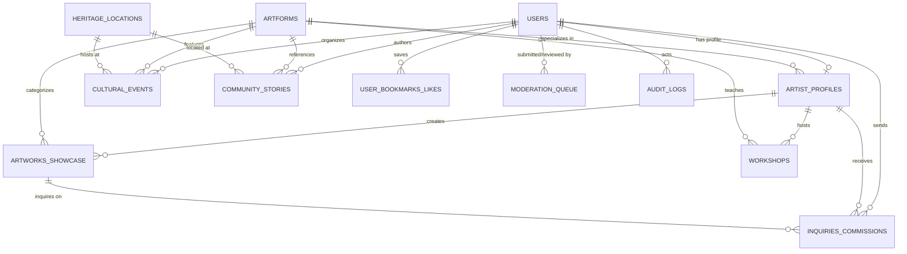
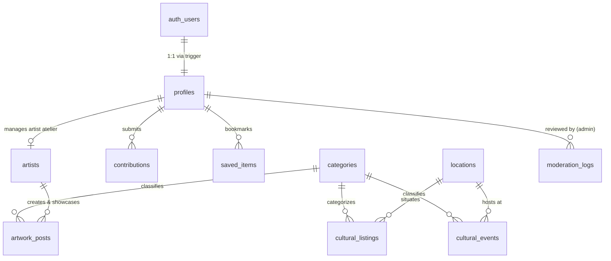

# Database Schema & Data Models
## KALAKRITI – Discover. Preserve. Showcase.
**PostgreSQL 16 + PostGIS Relational Schema & ORM Model**

---

### Document Control
- **Database Engine:** PostgreSQL 16+
- **Geospatial Extension:** PostGIS 3.4+
- **Performance Extensions:** `uuid-ossp`, `pg_trgm`, `unaccent`
- **ORM Compatibility:** Prisma ORM / Drizzle ORM
- **Collation:** UTF-8 (`en_US.UTF-8` with Unicode support for Malayalam `ml_IN`)

---

## 1. Entity-Relationship (ER) Architecture



---

## 2. PostgreSQL Extensions & Initialization Script

```sql
-- Enable cryptographic UUID generator
CREATE EXTENSION IF NOT EXISTS "uuid-ossp";

-- Enable PostGIS spatial database engine
CREATE EXTENSION IF NOT EXISTS "postgis";

-- Enable Trigram matching for fuzzy searching (e.g., Malayalam transliterations)
CREATE EXTENSION IF NOT EXISTS "pg_trgm";

-- Enable Unaccent for diacritic-insensitive search
CREATE EXTENSION IF NOT EXISTS "unaccent";
```

---

## 3. Detailed Table Specifications

### 3.1 Table: `users`
Core user identity for explorers, artists, curators, and administrators.

| Column | Type | Constraints | Default | Description |
| :--- | :--- | :--- | :--- | :--- |
| `id` | `UUID` | `PRIMARY KEY` | `uuid_generate_v4()` | Unique internal identifier |
| `email` | `VARCHAR(255)` | `UNIQUE`, `NULLABLE` | `NULL` | Explorer / curator login email |
| `phone_number` | `VARCHAR(20)` | `UNIQUE`, `NULLABLE` | `NULL` | Primary login for local artisans |
| `name` | `VARCHAR(150)` | `NOT NULL` | - | Full display name |
| `avatar_url` | `TEXT` | `NULLABLE` | `NULL` | Profile portrait image URL |
| `role` | `VARCHAR(30)` | `NOT NULL` | `'EXPLORER'` | `EXPLORER`, `ARTIST`, `ORGANIZER`, `CURATOR`, `ADMIN` |
| `preferred_language` | `VARCHAR(5)` | `NOT NULL` | `'ml'` | `'en'` or `'ml'` (Malayalam) |
| `is_verified` | `BOOLEAN` | `NOT NULL` | `false` | Global identity verification mark |
| `created_at` | `TIMESTAMPTZ` | `NOT NULL` | `NOW()` | Record creation timestamp |
| `updated_at` | `TIMESTAMPTZ` | `NOT NULL` | `NOW()` | Record modification timestamp |

---

### 3.2 Table: `artist_profiles`
Expanded profile for local traditional artisans, dancers, percussionists, and craftsmen.

| Column | Type | Constraints | Default | Description |
| :--- | :--- | :--- | :--- | :--- |
| `id` | `UUID` | `PRIMARY KEY` | `uuid_generate_v4()` | Unique profile identifier |
| `user_id` | `UUID` | `NOT NULL`, `UNIQUE`, `REFERENCES users(id) ON DELETE CASCADE` | - | Foreign key to user account |
| `stage_name` | `VARCHAR(150)` | `NULLABLE` | `NULL` | Traditional stage/honorific name (e.g. *Kalamandalam...*) |
| `bio_en` | `TEXT` | `NULLABLE` | `NULL` | English biography & lineage |
| `bio_ml` | `TEXT` | `NULLABLE` | `NULL` | Malayalam biography |
| `primary_artform_id`| `UUID` | `REFERENCES artforms(id)` | - | Master artform specialty |
| `guru_lineage` | `TEXT` | `NULLABLE` | `NULL` | Teachers and traditional parampara |
| `experience_years` | `INTEGER` | `NOT NULL` | `1` | Decades/years in practice |
| `studio_name` | `VARCHAR(200)` | `NULLABLE` | `NULL` | Workshop or *Kalari* name |
| `studio_address` | `TEXT` | `NULLABLE` | `NULL` | Physical street address |
| `taluk` | `VARCHAR(50)` | `NOT NULL` | `'Thrissur'` | `Thrissur`, `Mukundapuram`, `Kodungallur`, `Chavakkad`, `Chalakudy`, `Thalapilly` |
| `location_geom` | `GEOMETRY(Point, 4326)` | `NOT NULL` | - | Spatial coordinates (Longitude, Latitude) |
| `contact_phone` | `VARCHAR(20)` | `NULLABLE` | `NULL` | Public contact number |
| `whatsapp_number` | `VARCHAR(20)` | `NULLABLE` | `NULL` | WhatsApp inquiry number |
| `is_accepting_commissions` | `BOOLEAN` | `NOT NULL` | `true` | Ready for custom art / performance bookings |
| `verification_tier`| `VARCHAR(30)` | `NOT NULL` | `'UNVERIFIED'` | `'UNVERIFIED'`, `'UNDER_REVIEW'`, `'VERIFIED_MASTER'`, `'HERITAGE_GUILD'` |
| `verified_by` | `UUID` | `NULLABLE`, `REFERENCES users(id)` | `NULL` | Curator who approved verification |
| `verified_at` | `TIMESTAMPTZ` | `NULLABLE` | `NULL` | Date of verification badge award |
| `created_at` | `TIMESTAMPTZ` | `NOT NULL` | `NOW()` | Record creation timestamp |

---

### 3.3 Table: `artforms`
Taxonomy and living digital encyclopedia of Thrissur artforms.

| Column | Type | Constraints | Default | Description |
| :--- | :--- | :--- | :--- | :--- |
| `id` | `UUID` | `PRIMARY KEY` | `uuid_generate_v4()` | Unique artform identifier |
| `slug` | `VARCHAR(100)` | `UNIQUE`, `NOT NULL` | - | URL slug (e.g., `kathakali`, `pandi-melam`) |
| `name_en` | `VARCHAR(150)` | `NOT NULL` | - | English title |
| `name_ml` | `VARCHAR(150)` | `NOT NULL` | - | Malayalam title (e.g. 'കഥകളി') |
| `category` | `VARCHAR(50)` | `NOT NULL` | - | `PERFORMING_CLASSICAL`, `PERCUSSION_MELAM`, `FOLK_RITUAL`, `CRAFT_SCULPTURE`, `HANDLOOM_TEXTILE`, `THEATRE_LITERATURE` |
| `description_en` | `TEXT` | `NOT NULL` | - | Detailed English explanation |
| `description_ml` | `TEXT` | `NOT NULL` | - | Detailed Malayalam explanation |
| `history_and_origin`| `TEXT` | `NULLABLE` | `NULL` | Historical evolution and connection to Thrissur |
| `instruments_used` | `TEXT[]` | `DEFAULT '{}'` | - | Array of instruments (e.g., Chenda, Maddalam, Edakka, Ilathalam) |
| `audio_guide_url` | `TEXT` | `NULLABLE` | `NULL` | Pronunciation and audio sample file |
| `cover_image_url` | `TEXT` | `NOT NULL` | - | High-resolution hero image |
| `is_unesco_recognized` | `BOOLEAN` | `NOT NULL` | `false` | e.g. Koodiyattam UNESCO Intangible Heritage |
| `is_gi_tagged` | `BOOLEAN` | `NOT NULL` | `false` | e.g. Kuthampully Handloom, Nadavaramba Bell Metal |
| `created_at` | `TIMESTAMPTZ` | `NOT NULL` | `NOW()` | Record creation timestamp |

---

### 3.4 Table: `artworks_showcase`
Portfolios of traditional crafts, paintings, sculptures, and performance recordings.

| Column | Type | Constraints | Default | Description |
| :--- | :--- | :--- | :--- | :--- |
| `id` | `UUID` | `PRIMARY KEY` | `uuid_generate_v4()` | Unique artwork identifier |
| `artist_id` | `UUID` | `NOT NULL`, `REFERENCES artist_profiles(id) ON DELETE CASCADE` | - | Artisan creator reference |
| `artform_id` | `UUID` | `NOT NULL`, `REFERENCES artforms(id)` | - | Category reference |
| `title_en` | `VARCHAR(200)` | `NOT NULL` | - | English title |
| `title_ml` | `VARCHAR(200)` | `NULLABLE` | `NULL` | Malayalam title |
| `craft_technique` | `TEXT` | `NULLABLE` | `NULL` | Description of raw materials, dyes, and casting process |
| `medium` | `VARCHAR(100)` | `NULLABLE` | `NULL` | e.g. "Bronze Alloy (Panchaloham)", "Natural Pigment on Teak" |
| `dimensions` | `VARCHAR(100)` | `NULLABLE` | `NULL` | e.g. "48 x 36 inches", "Height: 24 inches, 12 kg" |
| `year_created` | `INTEGER` | `NULLABLE` | `NULL` | Creation year |
| `media_gallery` | `JSONB` | `NOT NULL` | `'[]'` | JSON array of `{url, blurhash, alt, caption, isCover}` |
| `video_embed_url` | `TEXT` | `NULLABLE` | `NULL` | YouTube / Vimeo performance demonstration |
| `price_indication` | `VARCHAR(50)` | `NULLABLE` | `NULL` | e.g. "₹25,000", "Price on Inquiry" |
| `is_for_sale` | `BOOLEAN` | `NOT NULL` | `false` | Available for direct purchase |
| `status` | `VARCHAR(30)` | `NOT NULL` | `'PUBLISHED'` | `'DRAFT'`, `'UNDER_REVIEW'`, `'PUBLISHED'`, `'ARCHIVED'` |
| `views_count` | `INTEGER` | `NOT NULL` | `0` | Analytics view counter |
| `created_at` | `TIMESTAMPTZ` | `NOT NULL` | `NOW()` | Record creation timestamp |

---

### 3.5 Table: `heritage_locations`
Sacred sites, palaces, cultural academies, and historic villages across Thrissur.

| Column | Type | Constraints | Default | Description |
| :--- | :--- | :--- | :--- | :--- |
| `id` | `UUID` | `PRIMARY KEY` | `uuid_generate_v4()` | Unique location identifier |
| `slug` | `VARCHAR(120)` | `UNIQUE`, `NOT NULL` | - | e.g. `vadakkunnathan-temple`, `shakthan-thampuran-palace` |
| `name_en` | `VARCHAR(200)` | `NOT NULL` | - | English landmark name |
| `name_ml` | `VARCHAR(200)` | `NOT NULL` | - | Malayalam landmark name |
| `category` | `VARCHAR(50)` | `NOT NULL` | - | `TEMPLE`, `CHURCH`, `MOSQUE`, `PALACE`, `ACADEMY`, `CRAFT_VILLAGE`, `MUSEUM` |
| `description_en` | `TEXT` | `NOT NULL` | - | Detailed architectural and cultural significance |
| `description_ml` | `TEXT` | `NOT NULL` | - | Malayalam architectural and cultural significance |
| `architectural_style` | `VARCHAR(100)` | `NULLABLE` | `NULL` | e.g. "Kerala Dravidian Wooden Architecture", "Dutch Colonial" |
| `historical_era` | `VARCHAR(100)` | `NULLABLE` | `NULL` | e.g. "8th Century CE", "Reign of Sakthan Thampuran (1789)" |
| `visiting_hours` | `VARCHAR(150)` | `NOT NULL` | - | e.g. "4:00 AM - 11:00 AM, 5:00 PM - 8:30 PM" |
| `entry_rules_dress_code`| `TEXT` | `NULLABLE` | `NULL` | Traditional dress guidelines (e.g. Mundu requirement) |
| `location_geom` | `GEOMETRY(Point, 4326)` | `NOT NULL` | - | Spatial coordinates (Point) |
| `address` | `TEXT` | `NOT NULL` | - | Physical postal address |
| `taluk` | `VARCHAR(50)` | `NOT NULL` | - | Taluk district division |
| `gallery_urls` | `TEXT[]` | `DEFAULT '{}'` | - | Curated photographs |
| `audio_guide_url` | `TEXT` | `NULLABLE` | `NULL` | Spoken narration of historical secrets |
| `is_verified` | `BOOLEAN` | `NOT NULL` | `true` | Authenticated heritage listing |
| `created_at` | `TIMESTAMPTZ` | `NOT NULL` | `NOW()` | Record creation timestamp |

---

### 3.6 Table: `cultural_events`
Festival calendars, temple poorams, theatre festivals, and classical concerts.

| Column | Type | Constraints | Default | Description |
| :--- | :--- | :--- | :--- | :--- |
| `id` | `UUID` | `PRIMARY KEY` | `uuid_generate_v4()` | Unique event identifier |
| `organizer_id` | `UUID` | `NOT NULL`, `REFERENCES users(id)` | - | Event publisher |
| `title_en` | `VARCHAR(250)` | `NOT NULL` | - | English event name |
| `title_ml` | `VARCHAR(250)` | `NOT NULL` | - | Malayalam event name |
| `slug` | `VARCHAR(150)` | `UNIQUE`, `NOT NULL` | - | URL slug |
| `description` | `TEXT` | `NOT NULL` | - | Event description & historical relevance |
| `artform_id` | `UUID` | `NULLABLE`, `REFERENCES artforms(id)` | `NULL` | Associated primary artform |
| `heritage_location_id`| `UUID` | `NULLABLE`, `REFERENCES heritage_locations(id)` | `NULL` | Associated landmark if held at a heritage site |
| `venue_name` | `VARCHAR(200)` | `NOT NULL` | - | e.g. "Thekkinkadu Maidan, Thrissur" |
| `location_geom` | `GEOMETRY(Point, 4326)` | `NOT NULL` | - | Venue coordinates |
| `start_time` | `TIMESTAMPTZ` | `NOT NULL` | - | Beginning datetime |
| `end_time` | `TIMESTAMPTZ` | `NOT NULL` | - | Ending datetime |
| `malayalam_month` | `VARCHAR(50)` | `NULLABLE` | `NULL` | e.g. "മേടം" (Medam), "മകരം" (Makaram) |
| `malayalam_star` | `VARCHAR(50)` | `NULLABLE` | `NULL` | e.g. "പൂരം" (Pooram), "ഉത്രം" (Uthram) |
| `ensemble_lineup` | `JSONB` | `DEFAULT '[]'` | - | Program timetable & lead melam masters |
| `banner_url` | `TEXT` | `NOT NULL` | - | Featured event poster |
| `is_free_entry` | `BOOLEAN` | `NOT NULL` | `true` | Free or ticketed access |
| `registration_url`| `TEXT` | `NULLABLE` | `NULL` | External booking or pass link |
| `status` | `VARCHAR(30)` | `NOT NULL` | `'PUBLISHED'` | `'DRAFT'`, `'UNDER_REVIEW'`, `'PUBLISHED'`, `'CANCELLED'` |
| `created_at` | `TIMESTAMPTZ` | `NOT NULL` | `NOW()` | Record creation timestamp |

---

### 3.7 Table: `workshops`
Masterclasses and workshops hosted by verified masters.

| Column | Type | Constraints | Default | Description |
| :--- | :--- | :--- | :--- | :--- |
| `id` | `UUID` | `PRIMARY KEY` | `uuid_generate_v4()` | Unique workshop identifier |
| `artist_id` | `UUID` | `NOT NULL`, `REFERENCES artist_profiles(id) ON DELETE CASCADE` | - | Hosting master artisan |
| `title` | `VARCHAR(200)` | `NOT NULL` | - | Workshop title |
| `artform_id` | `UUID` | `NOT NULL`, `REFERENCES artforms(id)` | - | Artform being taught |
| `description` | `TEXT` | `NOT NULL` | - | Syllabus, tools provided, learning outcome |
| `skill_level` | `VARCHAR(50)` | `NOT NULL` | `'ALL_LEVELS'` | `'BEGINNER'`, `'INTERMEDIATE'`, `'ADVANCED'`, `'ALL_LEVELS'` |
| `max_seats` | `INTEGER` | `NOT NULL` | `15` | Maximum class size |
| `fee_inr` | `INTEGER` | `NOT NULL` | `0` | Fee in INR (0 for free) |
| `start_date` | `TIMESTAMPTZ` | `NOT NULL` | - | Class date & time |
| `duration_hours` | `DECIMAL(4,1)` | `NOT NULL` | `2.5` | Duration of session |
| `venue_name` | `VARCHAR(200)` | `NOT NULL` | - | Workshop studio / Kalari location |
| `location_geom` | `GEOMETRY(Point, 4326)` | `NOT NULL` | - | Venue spatial point |
| `status` | `VARCHAR(30)` | `NOT NULL` | `'OPEN'` | `'OPEN'`, `'FULL'`, `'COMPLETED'`, `'CANCELLED'` |
| `created_at` | `TIMESTAMPTZ` | `NOT NULL` | `NOW()` | Record creation timestamp |

---

### 3.8 Table: `inquiries_commissions`
Direct patron-to-artist engagement without intermediate commissions.

| Column | Type | Constraints | Default | Description |
| :--- | :--- | :--- | :--- | :--- |
| `id` | `UUID` | `PRIMARY KEY` | `uuid_generate_v4()` | Unique inquiry identifier |
| `sender_id` | `UUID` | `NOT NULL`, `REFERENCES users(id)` | - | Inquiring patron |
| `artist_id` | `UUID` | `NOT NULL`, `REFERENCES artist_profiles(id)` | - | Recipient artisan |
| `artwork_id` | `UUID` | `NULLABLE`, `REFERENCES artworks_showcase(id)` | `NULL` | Specific piece if inquiry is tied to an artwork |
| `inquiry_type` | `VARCHAR(50)` | `NOT NULL` | `'COMMISSION'` | `'COMMISSION'`, `'PERFORMANCE_BOOKING'`, `'PURCHASE'`, `'WORKSHOP_QUERY'` |
| `message` | `TEXT` | `NOT NULL` | - | Detailed requirement / date of festival |
| `budget_range` | `VARCHAR(100)` | `NULLABLE` | `NULL` | Estimated patron budget |
| `sender_contact` | `VARCHAR(100)` | `NOT NULL` | - | Sender phone or email for direct callback |
| `status` | `VARCHAR(30)` | `NOT NULL` | `'NEW'` | `'NEW'`, `'READ'`, `'REPLIED'`, `'CLOSED'` |
| `created_at` | `TIMESTAMPTZ` | `NOT NULL` | `NOW()` | Record creation timestamp |

---

### 3.9 Table: `moderation_queue`
Centralized review queue for platform curators.

| Column | Type | Constraints | Default | Description |
| :--- | :--- | :--- | :--- | :--- |
| `id` | `UUID` | `PRIMARY KEY` | `uuid_generate_v4()` | Unique queue item identifier |
| `entity_type` | `VARCHAR(50)` | `NOT NULL` | - | `'ARTIST_VERIFICATION'`, `'ARTWORK'`, `'EVENT'`, `'COMMUNITY_STORY'` |
| `entity_id` | `UUID` | `NOT NULL` | - | Target row ID in respective table |
| `submitted_by` | `UUID` | `NOT NULL`, `REFERENCES users(id)` | - | Submitter user |
| `reviewed_by` | `UUID` | `NULLABLE`, `REFERENCES users(id)` | `NULL` | Curator who resolved the item |
| `status` | `VARCHAR(30)` | `NOT NULL` | `'PENDING'` | `'PENDING'`, `'APPROVED'`, `'NEEDS_REVISION'`, `'REJECTED'` |
| `automated_flags`| `JSONB` | `DEFAULT '[]'` | - | Heuristic scanner flags (e.g. copyright match) |
| `curator_notes` | `TEXT` | `NULLABLE` | `NULL` | Internal curator comments or feedback to author |
| `created_at` | `TIMESTAMPTZ` | `NOT NULL` | `NOW()` | Submission timestamp |
| `reviewed_at` | `TIMESTAMPTZ` | `NULLABLE` | `NULL` | Resolution timestamp |

---

## 4. Key Geospatial Queries & Functions

### 4.1 Finding Nearest Master Artisans (Radius in Meters)
```sql
CREATE OR REPLACE FUNCTION get_nearby_artists(
    user_lon DOUBLE PRECISION,
    user_lat DOUBLE PRECISION,
    radius_meters DOUBLE PRECISION DEFAULT 25000
)
RETURNS TABLE (
    artist_id UUID,
    stage_name VARCHAR,
    studio_name VARCHAR,
    artform_name_en VARCHAR,
    distance_meters DOUBLE PRECISION,
    latitude DOUBLE PRECISION,
    longitude DOUBLE PRECISION
) AS $$
BEGIN
    RETURN QUERY
    SELECT 
        ap.id AS artist_id,
        ap.stage_name,
        ap.studio_name,
        af.name_en AS artform_name_en,
        ST_DistanceSphere(
            ap.location_geom, 
            ST_SetSRID(ST_MakePoint(user_lon, user_lat), 4326)
        ) AS distance_meters,
        ST_Y(ap.location_geom::geometry) AS latitude,
        ST_X(ap.location_geom::geometry) AS longitude
    FROM artist_profiles ap
    JOIN artforms af ON ap.primary_artform_id = af.id
    WHERE ST_DWithin(
        ap.location_geom::geography,
        ST_SetSRID(ST_MakePoint(user_lon, user_lat), 4326)::geography,
        radius_meters
    )
    AND ap.verification_tier IN ('VERIFIED_MASTER', 'HERITAGE_GUILD')
    ORDER BY distance_meters ASC;
END;
$$ LANGUAGE plpgsql;
```

---

## 5. Complete Prisma ORM Schema (`prisma/schema.prisma`)

```prisma
datasource db {
  provider   = "postgresql"
  url        = env("DATABASE_URL")
  extensions = [postgis, pg_trgm, unaccent, uuid_ossp(map: "uuid-ossp")]
}

generator client {
  provider        = "prisma-client-js"
  previewFeatures = ["postgresqlExtensions"]
}

enum UserRole {
  EXPLORER
  ARTIST
  ORGANIZER
  CURATOR
  ADMIN
}

enum VerificationTier {
  UNVERIFIED
  UNDER_REVIEW
  VERIFIED_MASTER
  HERITAGE_GUILD
}

enum ArtformCategory {
  PERFORMING_CLASSICAL
  PERCUSSION_MELAM
  FOLK_RITUAL
  CRAFT_SCULPTURE
  HANDLOOM_TEXTILE
  THEATRE_LITERATURE
}

model User {
  id                String             @id @default(dbgenerated("uuid_generate_v4()")) @db.Uuid
  email             String?            @unique @db.VarChar(255)
  phoneNumber       String?            @unique @map("phone_number") @db.VarChar(20)
  name              String             @db.VarChar(150)
  avatarUrl         String?            @map("avatar_url") @db.Text
  role              UserRole           @default(EXPLORER)
  preferredLanguage String             @default("ml") @map("preferred_language") @db.VarChar(5)
  isVerified        Boolean            @default(false) @map("is_verified")
  createdAt         DateTime           @default(now()) @map("created_at") @db.Timestamptz(6)
  updatedAt         DateTime           @default(now()) @updatedAt @map("updated_at") @db.Timestamptz(6)

  artistProfile     ArtistProfile?
  organizedEvents   CulturalEvent[]
  inquiriesSent     InquiryCommission[] @relation("SenderInquiries")
  moderationsDone   ModerationQueue[]   @relation("CuratorReviews")
  moderationsSent   ModerationQueue[]   @relation("UserSubmissions")
  auditLogs         AuditLog[]

  @@map("users")
}

model ArtistProfile {
  id                     String           @id @default(dbgenerated("uuid_generate_v4()")) @db.Uuid
  userId                 String           @unique @map("user_id") @db.Uuid
  stageName              String?          @map("stage_name") @db.VarChar(150)
  bioEn                  String?          @map("bio_en") @db.Text
  bioMl                  String?          @map("bio_ml") @db.Text
  primaryArtformId       String           @map("primary_artform_id") @db.Uuid
  guruLineage            String?          @map("guru_lineage") @db.Text
  experienceYears        Int              @default(1) @map("experience_years")
  studioName             String?          @map("studio_name") @db.VarChar(200)
  studioAddress          String?          @map("studio_address") @db.Text
  taluk                  String           @default("Thrissur") @db.VarChar(50)
  contactPhone           String?          @map("contact_phone") @db.VarChar(20)
  whatsappNumber         String?          @map("whatsapp_number") @db.VarChar(20)
  isAcceptingCommissions Boolean          @default(true) @map("is_accepting_commissions")
  verificationTier       VerificationTier @default(UNVERIFIED) @map("verification_tier")
  verifiedById           String?          @map("verified_by") @db.Uuid
  verifiedAt             DateTime?        @map("verified_at") @db.Timestamptz(6)
  createdAt              DateTime         @default(now()) @map("created_at") @db.Timestamptz(6)

  user                   User             @relation(fields: [userId], references: [id], onDelete: Cascade)
  primaryArtform         Artform          @relation(fields: [primaryArtformId], references: [id])
  artworks               ArtworkShowcase[]
  workshops              Workshop[]
  inquiriesReceived      InquiryCommission[]

  @@map("artist_profiles")
}

model Artform {
  id                 String          @id @default(dbgenerated("uuid_generate_v4()")) @db.Uuid
  slug               String          @unique @db.VarChar(100)
  nameEn             String          @map("name_en") @db.VarChar(150)
  nameMl             String          @map("name_ml") @db.VarChar(150)
  category           ArtformCategory
  descriptionEn      String          @map("description_en") @db.Text
  descriptionMl      String          @map("description_ml") @db.Text
  historyAndOrigin   String?         @map("history_and_origin") @db.Text
  instrumentsUsed    String[]        @default([]) @map("instruments_used")
  audioGuideUrl      String?         @map("audio_guide_url") @db.Text
  coverImageUrl      String          @map("cover_image_url") @db.Text
  isUnescoRecognized Boolean         @default(false) @map("is_unesco_recognized")
  isGiTagged         Boolean         @default(false) @map("is_gi_tagged")
  createdAt          DateTime        @default(now()) @map("created_at") @db.Timestamptz(6)

  artists            ArtistProfile[]
  artworks           ArtworkShowcase[]
  events             CulturalEvent[]
  workshops          Workshop[]

  @@map("artforms")
}

model ArtworkShowcase {
  id              String   @id @default(dbgenerated("uuid_generate_v4()")) @db.Uuid
  artistId        String   @map("artist_id") @db.Uuid
  artformId       String   @map("artform_id") @db.Uuid
  titleEn         String   @map("title_en") @db.VarChar(200)
  titleMl         String?  @map("title_ml") @db.VarChar(200)
  craftTechnique  String?  @map("craft_technique") @db.Text
  medium          String?  @db.VarChar(100)
  dimensions      String?  @db.VarChar(100)
  yearCreated     Int?     @map("year_created")
  mediaGallery    Json     @default("[]") @map("media_gallery")
  videoEmbedUrl   String?  @map("video_embed_url") @db.Text
  priceIndication String?  @map("price_indication") @db.VarChar(50)
  isForSale       Boolean  @default(false) @map("is_for_sale")
  status          String   @default("PUBLISHED") @db.VarChar(30)
  viewsCount      Int      @default(0) @map("views_count")
  createdAt       DateTime @default(now()) @map("created_at") @db.Timestamptz(6)

  artist          ArtistProfile       @relation(fields: [artistId], references: [id], onDelete: Cascade)
  artform         Artform             @relation(fields: [artformId], references: [id])
  inquiries       InquiryCommission[]

  @@map("artworks_showcase")
}

model HeritageLocation {
  id                  String   @id @default(dbgenerated("uuid_generate_v4()")) @db.Uuid
  slug                String   @unique @db.VarChar(120)
  nameEn              String   @map("name_en") @db.VarChar(200)
  nameMl              String   @map("name_ml") @db.VarChar(200)
  category            String   @db.VarChar(50)
  descriptionEn       String   @map("description_en") @db.Text
  descriptionMl       String   @map("description_ml") @db.Text
  architecturalStyle  String?  @map("architectural_style") @db.VarChar(100)
  historicalEra       String?  @map("historical_era") @db.VarChar(100)
  visitingHours       String   @map("visiting_hours") @db.VarChar(150)
  entryRulesDressCode String?  @map("entry_rules_dress_code") @db.Text
  address             String   @db.Text
  taluk               String   @db.VarChar(50)
  galleryUrls         String[] @default([]) @map("gallery_urls")
  audioGuideUrl       String?  @map("audio_guide_url") @db.Text
  isVerified          Boolean  @default(true) @map("is_verified")
  createdAt           DateTime @default(now()) @map("created_at") @db.Timestamptz(6)

  events              CulturalEvent[]

  @@map("heritage_locations")
}

model CulturalEvent {
  id                 String            @id @default(dbgenerated("uuid_generate_v4()")) @db.Uuid
  organizerId        String            @map("organizer_id") @db.Uuid
  titleEn            String            @map("title_en") @db.VarChar(250)
  titleMl            String            @map("title_ml") @db.VarChar(250)
  slug               String            @unique @db.VarChar(150)
  description        String            @db.Text
  artformId          String?           @map("artform_id") @db.Uuid
  heritageLocationId String?           @map("heritage_location_id") @db.Uuid
  venueName          String            @map("venue_name") @db.VarChar(200)
  startTime          DateTime          @map("start_time") @db.Timestamptz(6)
  endTime            DateTime          @map("end_time") @db.Timestamptz(6)
  malayalamMonth     String?           @map("malayalam_month") @db.VarChar(50)
  malayalamStar      String?           @map("malayalam_star") @db.VarChar(50)
  ensembleLineup     Json              @default("[]") @map("ensemble_lineup")
  bannerUrl          String            @map("banner_url") @db.Text
  isFreeEntry        Boolean           @default(true) @map("is_free_entry")
  registrationUrl    String?           @map("registration_url") @db.Text
  status             String            @default("PUBLISHED") @db.VarChar(30)
  createdAt          DateTime          @default(now()) @map("created_at") @db.Timestamptz(6)

  organizer          User              @relation(fields: [organizerId], references: [id])
  artform            Artform?          @relation(fields: [artformId], references: [id])
  heritageLocation   HeritageLocation? @relation(fields: [heritageLocationId], references: [id])

  @@map("cultural_events")
}

model Workshop {
  id             String        @id @default(dbgenerated("uuid_generate_v4()")) @db.Uuid
  artistId       String        @map("artist_id") @db.Uuid
  title          String        @db.VarChar(200)
  artformId      String        @map("artform_id") @db.Uuid
  description    String        @db.Text
  skillLevel     String        @default("ALL_LEVELS") @map("skill_level") @db.VarChar(50)
  maxSeats       Int           @default(15) @map("max_seats")
  feeInr         Int           @default(0) @map("fee_inr")
  startDate      DateTime      @map("start_date") @db.Timestamptz(6)
  durationHours  Decimal       @default(2.5) @map("duration_hours") @db.Decimal(4, 1)
  venueName      String        @map("venue_name") @db.VarChar(200)
  status         String        @default("OPEN") @db.VarChar(30)
  createdAt      DateTime      @default(now()) @map("created_at") @db.Timestamptz(6)

  artist         ArtistProfile @relation(fields: [artistId], references: [id], onDelete: Cascade)
  artform        Artform       @relation(fields: [artformId], references: [id])

  @@map("workshops")
}

model InquiryCommission {
  id            String           @id @default(dbgenerated("uuid_generate_v4()")) @db.Uuid
  senderId      String           @map("sender_id") @db.Uuid
  artistId      String           @map("artist_id") @db.Uuid
  artworkId     String?          @map("artwork_id") @db.Uuid
  inquiryType   String           @default("COMMISSION") @map("inquiry_type") @db.VarChar(50)
  message       String           @db.Text
  budgetRange   String?          @map("budget_range") @db.VarChar(100)
  senderContact String           @map("sender_contact") @db.VarChar(100)
  status        String           @default("NEW") @db.VarChar(30)
  createdAt     DateTime         @default(now()) @map("created_at") @db.Timestamptz(6)

  sender        User             @relation("SenderInquiries", fields: [senderId], references: [id])
  artist        ArtistProfile    @relation(fields: [artistId], references: [id])
  artwork       ArtworkShowcase? @relation(fields: [artworkId], references: [id])

  @@map("inquiries_commissions")
}

model ModerationQueue {
  id             String    @id @default(dbgenerated("uuid_generate_v4()")) @db.Uuid
  entityType     String    @map("entity_type") @db.VarChar(50)
  entityId       String    @map("entity_id") @db.Uuid
  submittedById  String    @map("submitted_by") @db.Uuid
  reviewedById   String?   @map("reviewed_by") @db.Uuid
  status         String    @default("PENDING") @db.VarChar(30)
  automatedFlags Json      @default("[]") @map("automated_flags")
  curatorNotes   String?   @map("curator_notes") @db.Text
  createdAt      DateTime  @default(now()) @map("created_at") @db.Timestamptz(6)
  reviewedAt     DateTime? @map("reviewed_at") @db.Timestamptz(6)

  submittedBy    User      @relation("UserSubmissions", fields: [submittedById], references: [id])
  reviewedBy     User?     @relation("CuratorReviews", fields: [reviewedById], references: [id])

  @@map("moderation_queue")
}

model AuditLog {
  id          String   @id @default(dbgenerated("uuid_generate_v4()")) @db.Uuid
  actorId     String?  @map("actor_id") @db.Uuid
  action      String   @db.VarChar(100)
  targetTable String   @map("target_table") @db.VarChar(50)
  targetId    String   @map("target_id") @db.Uuid
  payload     Json?
  ipAddress   String?  @map("ip_address") @db.VarChar(45)
  createdAt   DateTime @default(now()) @map("created_at") @db.Timestamptz(6)

  actor       User?    @relation(fields: [actorId], references: [id])

  @@map("audit_logs")
}
```

---

## 6. Live Supabase PostgreSQL Schema & Row Level Security (RLS) Matrix

The live deployment of KALAKRITI utilizes a production-grade PostgreSQL database hosted on **Supabase** with automated authentication integration (`auth.users`), declarative Row Level Security (RLS) on all 10 core tables, and dedicated cloud storage policies.

### 6.1 Database Architecture Overview



### 6.2 The 10 Production Tables

| # | Table Name | Primary Key | Foreign Keys | Role / Function |
|---|------------|-------------|--------------|-----------------|
| 1 | `profiles` | `id` (UUID references `auth.users.id`) | `auth.users(id) ON DELETE CASCADE` | User identity with role (`visitor`, `registered_user`, `artist`, `admin`) |
| 2 | `artists` | `id` (UUID) | `profile_id` &rarr; `profiles(id)` | Living master artisans, lineage, studio taluk, verification badge, contact/WhatsApp |
| 3 | `cultural_listings` | `id` (UUID) | `category_id` &rarr; `categories`, `location_id` &rarr; `locations`, `submitted_by` &rarr; `profiles` | Heritage sites, craft clusters, academies with bilingual descriptions & coordinates |
| 4 | `artwork_posts` | `id` (UUID) | `artist_id` &rarr; `artists`, `category_id` &rarr; `categories`, `submitted_by` &rarr; `profiles` | Community and master artwork showcase items with multi-image galleries and moderation status |
| 5 | `cultural_events` | `id` (UUID) | `category_id` &rarr; `categories`, `submitted_by` &rarr; `profiles` | Cultural calendar events with upcoming/past/unconfirmed statuses and verification flags |
| 6 | `categories` | `id` (UUID) | None | Cultural categories (Traditional Art, Performing Arts, Handicrafts, Heritage, Festivals, Workshops) |
| 7 | `locations` | `id` (UUID) | None | Thrissur district taluks and heritage hubs with GPS coordinates |
| 8 | `contributions` | `id` (UUID) | `user_id` &rarr; `profiles(id)` | Audit track of community-submitted listings, artworks, and events |
| 9 | `moderation_logs` | `id` (UUID) | `reviewer_id` &rarr; `profiles(id)` | Curator review audit trail with status decisions (`approved`, `rejected`) and notes |
| 10 | `saved_items` | `id` (UUID) | `user_id` &rarr; `profiles(id)` | Explorer bookmarks for listings, artworks, artists, and events (`UNIQUE(user_id, item_type, item_id)`) |

---

### 6.3 User Roles & Authorization Matrix

| User Role | Public Browsing | Save / Bookmark | Submit Artwork | Submit Listings / Events | Delete Own Items | Moderate Content |
|:----------|:---------------:|:---------------:|:--------------:|:------------------------:|:----------------:|:----------------:|
| **Visitor** | Approved only | ❌ | ❌ | ❌ | ❌ | ❌ |
| **Registered User** | Approved only | ✅ | ❌ | ✅ (Pending moderation) | ❌ | ❌ |
| **Artist** | Approved only | ✅ | ✅ (Multiple photos) | ✅ (Pending moderation) | ✅ (Own items) | ❌ |
| **Admin** | All statuses | ✅ | ✅ | ✅ | ✅ | ✅ (Approve / Reject) |

---

### 6.4 Row Level Security (RLS) Policy Implementation

Every table has `ENABLE ROW LEVEL SECURITY` activated. Content publication is strictly moderated: **only records with `status = 'approved'` are publicly readable by unauthenticated visitors**.

#### Policy Summary:

1. **`profiles`:**
   - Public can view display profiles.
   - Users can update their own profile (`id = auth.uid()`).
   - Automated registration trigger creates profile on `auth.users` insert.

2. **`artists`:**
   - Visitors can read approved artists (`status = 'approved'`).
   - Authenticated artists can view/edit their own profile (`profile_id = auth.uid()`).
   - Admins have full access.

3. **`cultural_listings`:**
   - Public can view approved listings (`status = 'approved'`).
   - Registered users can insert new listings (`status = 'pending'`).
   - Creators can view their own pending listings.
   - Admins can view, edit, approve, or reject any listing.

4. **`artwork_posts`:**
   - Public can view approved artwork (`status = 'approved'`).
   - Artists can insert artwork for their artist record.
   - Artists can update and delete their own artwork (`submitted_by = auth.uid()`).
   - Admins have full review and deletion rights.

5. **`cultural_events`:**
   - Public can view approved events (`moderation_status = 'approved'`).
   - Registered users and organizers can submit events.
   - Admins can publish, reject, and update confirmation statuses.

6. **`saved_items`:**
   - Users can only read, insert, and delete their own saved bookmarks (`user_id = auth.uid()`).

7. **`moderation_logs`:**
   - Admins only for insert and select.

---

### 6.5 Supabase Cloud Storage Policy (`kalakriti-media`)

- **Bucket Name:** `kalakriti-media` (Public bucket for fast CDN image delivery).
- **Storage Path Structure:**
  - `artwork/{userId}/{timestamp}_{filename}`
  - `artists/{userId}/{timestamp}_{filename}`
  - `listings/{userId}/{timestamp}_{filename}`
  - `events/{userId}/{timestamp}_{filename}`
- **Security Policies:**
  - `Public Access`: Anyone can view media files.
  - `Authenticated Upload`: Any authenticated user can upload files under their designated path.
  - `Owner Modification/Deletion`: Users can only replace or delete their own media assets.

---

### 6.6 Applying Migrations

The complete, self-contained SQL DDL and seed files are located in the repository:
- `supabase/migrations/20261107000000_kalakriti_schema.sql` — Schema, triggers, enums, tables, and RLS policies.
- `supabase/seed.sql` — Categories, Thrissur taluks, 6 master artists, and 15 cultural listings.

They can be applied either via the **Supabase Dashboard SQL Editor** or using the **Supabase CLI**:
```bash
# Push migrations to linked Supabase project
npx supabase db push

# Or execute seed data directly
psql -h db.your-supabase-id.supabase.co -U postgres -d postgres -f supabase/seed.sql
```


